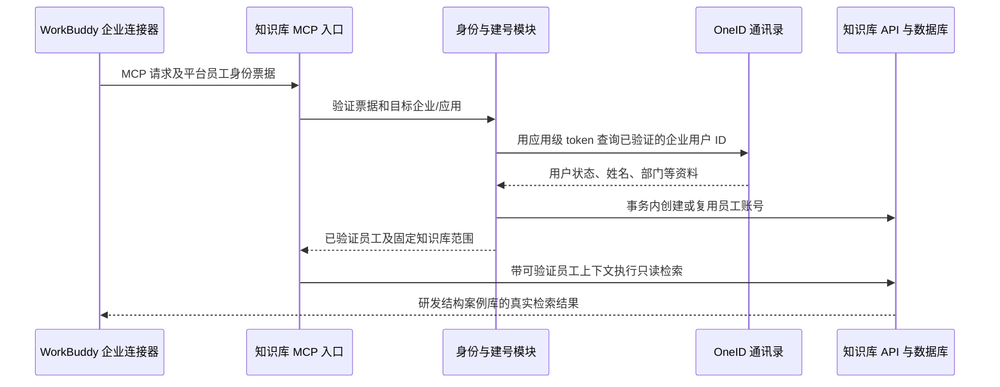

# WorkBuddy 自建应用免授权与 OneID 自动建号方案

> 后续设计：[员工账号与中心知识库授权](2026-10-15-workbuddy-employee-center-access-design.md)。用户现已确认按中心分库授权；本文“员工统一访问固定库”等前期约束由新设计替代。身份、企业与部门父链已在独立原型验证，生产接入仍待实施。

日期：2026-10-14

状态：用户已认可组合方案，本文为书面设计；平台身份票据协议待取得，生产接入尚未实现。

## 1. 目标与范围

员工使用 WorkBuddy 企业连接器“研发案例知识库”时，由平台传递当前员工身份。知识库验证身份后，通过同一自建应用的 OneID 通讯录能力补全资料，自动创建或复用账号，再提供指定案例库的只读检索。

- 本企业所有员工均可准入；WorkBuddy 管理员设置连接器可见范围。
- 首次联调限定“研发结构案例库”，使用经确认的唯一知识库 ID，名称不用于鉴权。
- 后台可识别实际员工；首期不建设部门分库权限系统。
- 部门等资料用于用户展示和后续扩展，不将有部门字段作为首期准入条件。
- 选择平台免授权模式：目标是不要求员工输入 Key，也不为资料补全再发起浏览器授权。

## 2. 证据与边界

| 能力 | 现有证据 |
| --- | --- |
| 平台免授权传递员工身份 | 用户控制台明确说明传递企业用户 ID 与本应用维度 openid，尚未收到真实 MCP 请求验证 |
| 自建应用 OneID 登录与 UserInfo | 独立原型已实测；第三次授权复用测试账号，成功取得姓名、用户名、tid 和部门 ID |
| 资料完整性 | 实测邮箱、手机号、头像为空；接口能力不代表企业已维护全部资料 |
| 通讯录补查 | 官方提供按 OneID 企业用户 ID 查询姓名、状态、部门、工号等资料的接口；支持应用级 token |
| 免授权身份票据协议 | 当前公开连接器文档未覆盖该新增模式，尚缺请求头、验证规则、ID 映射和失效规则 |

既有 OneID 原型验证了授权码流程，不等于已验证免授权连接器。保留原型作为资料接口验证工具，其测试用户数据库不导入生产账号。

当前控制台曾提示缺少“客户端菜单”的查看权限，需由企业超级管理员开通对应权限，或代为选择已创建的自建应用。选择应用后的配置说明及官方接入文档是下一步所需输入。

## 3. 推荐架构



建号触发点是服务端收到的首次有效、已认证 MCP 请求。员工仅在界面看到或点击连接器，但请求尚未到达知识库时，不承诺后台已建号。

### 平台身份验证

独立适配器按官方契约验证身份票据及企业、应用、目标服务、有效期等约束。具体请求头、票据类型、签名或远端验证接口必须来自官方说明，不能根据字段名称猜测。

如果协议采用签名票据，按文档限定可信签发方、公钥来源及受众；如果采用服务端换票或验证接口，严格使用固定可信端点及规定参数。未验证的 JWT 解码结果、明文用户 ID、自填姓名都不能创建员工上下文。

应用级 token 用来查询通讯录，不能单独作为“当前员工已登录”的证明。客户端传来的待查询 ID 必须来自通过验证的票据，不能允许工具参数选择另一个员工。

### OneID 补全资料

使用既有自建应用 Client ID / Client Secret 在服务端获取应用级 token，并在内存或受保护缓存中复用，按返回有效期提前刷新；凭据不交给 WorkBuddy 或浏览器，不写日志。

调用官方接口：

```http
GET /openapi/v3/contacts/users/:union_id?ignore_status=false
Authorization: Bearer <应用级 access_token>
```

`:union_id` 必须是已核实映射后的 OneID 企业用户 ID。接口的 origin 从官方调用说明配置，禁止拼接用户提交的 URL。接口返回的 `data.user.union_id` 必须与查询目标一致，用户必须处于正常状态。

优先获取：`union_id`、`name`、`status`、`alias_id`、`departments`。部门对象包含 ID、名称、上级 ID 和主部门标记。工号、职位可作为资料保存；字段为空则保留空值。通讯录接口与 OIDC UserInfo 的字段结构不同，分别适配，不承诺邮箱、手机号、头像字段完全相同。

应用通讯录权限决定查询范围。本次首次请求只查当前员工，不拉取或创建全公司账号，不修改 OneID 员工资料。

首次建号必须查询成功。后续允许缓存已验证的正常用户资料最长 5 分钟；过期后须重新查询，查询失败或用户异常时拒绝继续访问。本地停用每次请求都检查，不受该缓存影响。企业侧停用的生效时间还受平台数据同步与票据机制影响，真实联调时记录。

## 4. 账号绑定与资料更新

以可信 OneID 企业标识和 `union_id` 作为生产身份唯一键。平台自建应用 ID、应用维度 openid 另存为身份别名，以便审计和识别应用变更。

不能假设之前原型中的 OIDC `sub`、本应用 openid 和 `union_id` 相等。正式映射必须有官方定义或可验证转换结果；仅凭样例数字相同不能建立通用映射规则。拿不到经过验证的企业用户 ID 时返回身份无法解析，不猜测或按姓名匹配。

- 首次请求：验证身份、企业归属、正常员工状态及检索范围后，在事务中创建 User 与外部身份记录。
- 再次请求：根据稳定身份复用账号，在资料更新时同步姓名和部门；同名员工仍是不同账号。
- 并发首次请求：数据库身份唯一约束保证不重复建号。
- 本地停用账号：不因平台再次传来有效身份而自动恢复。
- 更换自建应用：重新核实身份票据受众与 ID 映射，企业用户身份一致才能复用；不按 openid 跨应用合并。

现有 User.email 非空且唯一。缺少真实邮箱时使用保留 `.invalid` 域的内部账号标识并明确标注，不能伪称员工邮箱。增加 MCP 专用账号类型，不设置可用密码、不开放邮件找回、不创建个人知识库租户、不自动加入可编辑内容的团队。保留现有网页用户的登录行为。

后台复用既有用户列表及停用入口，增加身份来源、部门、最后访问和资料同步时间。外部资料更新不覆盖管理员控制的账号状态和知识库授权。

## 5. 每次检索的授权

把平台身份验证结果转换为服务端员工上下文，再使用固定的知识库 allowlist 和只读 scope。员工 ID 与知识库数据租户必须分开：员工用于鉴权审计，数据索引和模型从获准知识库记录解析。

MCP 到知识库 API 的员工上下文须经过后端验证或受认证的内部传递，禁止接受任意来源的明文用户头。具体协议在平台票据契约确认后写入实施计划，不临时用共享管理员 Key 替代个人身份。

检索、知识库/文档列表、chunks、引用图片都检查库归属；缓存命中也不能跳过鉴权。写入、删除、管理和原始文件下载不在本授权范围内。复用已有 scoped Key 校验逻辑，但不能将无上下文解释为无限制访问。

日志只记录员工、本次调用、知识库及结果状态；身份票据、token、Secret 不记录。平台禁止访问或本地停用时拒绝请求，不降级到旧 Key。连接器隐藏、停用是否停止新票据签发，以及已发票据何时失效，在真实联调中确认，不预设为即时撤销。

## 6. 对原方案的调整

首选路径采用平台身份委托，因此不再按旧计划优先建设：动态客户端注册、自建授权页、OneID 浏览器回调，以及向 WorkBuddy 签发个人 OAuth access/refresh token 的系统。

保留并实现：身份验证、企业检查、OneID 查询、自动建号、员工与数据租户分离、库范围限制、后台停用及审计。这些是可信地按员工访问知识库所需的实际工作。

标准 MCP OAuth 文档的 HTTPS 要求不能直接作为这个新增专用模式所有网络行为的证据。生产入口仍以 TLS 为设计要求，可复用公司 HTTPS 网关；平台网关到内网 MCP 是否支持 HTTP、从哪里发请求及如何保护票据，需该模式官方说明和实际联调确认。当前内网 HTTP 配置保存成功不等于传输机制已验证。

## 7. 实施顺序和验收

1. **确认平台契约**：解决自建应用选择权限，取得官方接入说明，明确传递头/票据、验证方式、企业/应用受众、ID 映射、有效期及网络要求。
2. **隔离验证身份与资料**：测试 MCP 接收一次平台请求，完成票据验证后仅查询该员工通讯录；确认姓名和部门。未知票据不得仅解码后标记验证成功。
3. **接入正式用户与检索**：真实 User 建号，限定“研发结构案例库”，验证员工与数据租户分离及禁止写操作。
4. **两名员工联调**：分别连接、检索和查看后台记录；再次连接复用用户，停用后拒绝访问；检查跨库请求和票据串用被拒绝。
5. **生产迁移**：配置连接器可见范围与正式入口，盘点旧共享 Key；其撤销和正式切换在确认影响范围后执行。

完成标准：员工无需输入 Key 或另行浏览器授权，真实 WorkBuddy 请求经过身份校验，后台自动识别/创建该员工，补全 OneID 可提供的资料，并返回“研发结构案例库”的真实检索结果。

平台契约未取得前，可以继续准备代码结构和测试方案，但不能把未知签名或 Header 格式写成确定实现，也不能报告免授权接入已成功。

## 8. 官方依据

- [OneID 自建应用](https://identity.tencent.com/docs/guides/application/Self-built/)：支持 SSO 和通讯录访问，应用级 token 的范围由应用通讯录权限决定。
- [查询企业用户信息](https://identity.tencent.com/docs/openapi/contact/user/get/)：按企业用户 ID 查询用户状态、姓名及部门等信息，支持应用级 token。
- [获取访问凭证](https://identity.tencent.com/docs/openapi/api-guide/get-token/)：应用级和用户级 token 的获取与使用。
- [WorkBuddy 企业连接器管理](https://cloud.tencent.com/document/product/1831/134453)：截至本次查询仍未覆盖截图中的新增免授权模式，不能据此推定其票据契约。

本文件替代旧的标准 MCP OAuth 首选设计；旧设计和计划保留为备选资料，生产代码尚未修改。
