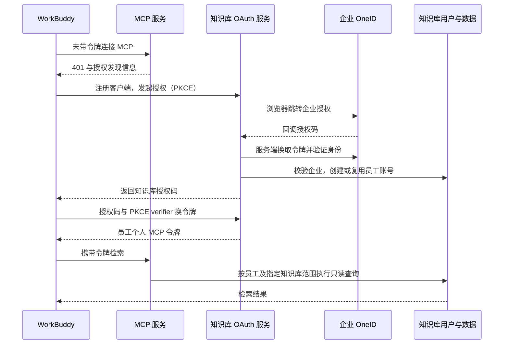

# WorkBuddy 企业员工 OAuth 接入研发案例知识库

> 已由[自建应用免授权 + OneID 资料补全方案](2026-10-14-workbuddy-delegated-identity-design.md)替代。以下保留为标准 MCP OAuth 备选方案，不再按本文启动实施。用户已选择优先使用平台提供的员工身份票据。

日期：2026-10-14

状态：设计待评审；独立身份验证原型已验证，生产接入尚未实现。

本轮优先级更新：先交付 WorkBuddy → OneID OAuth → MCP → 真实检索的完整链路，再完善后台展示。用户已指定首次联调知识库为“研发结构案例库”。实施前解析其唯一 ID，联调授权只包含该库；同名库不得自行任选。实施步骤见 `../plans/2026-10-14-workbuddy-mcp-oauth-e2e.md`。

## 1. 目标与首期规则

员工在 WorkBuddy 企业连接器中点击“研发案例知识库”，经过企业 OneID 授权后，知识库自动创建或复用员工账号。随后使用个人 MCP 访问令牌检索指定的研发案例库，后台可以识别实际使用者。

用户确认的准入规则：**本企业所有员工均可访问；WorkBuddy 管理员控制连接器对谁可见。**

| 层次 | 首期职责 |
| --- | --- |
| WorkBuddy | 控制连接器展示范围，发起个人 OAuth 授权，保存个人凭据 |
| 腾讯 OneID | 提供可验证的登录身份和企业归属信息 |
| 知识库认证服务 | 校验企业归属，自动建号，签发和撤销个人访问凭据 |
| MCP 与知识库 API | 每次请求检查账号、授权及知识库范围，只提供允许的检索能力 |

企业内不再按部门区分权限，不要求管理员逐人分配知识库。后台只配置一组允许检索的知识库 ID，所有通过企业校验的员工适用同一范围。上传、删除、修改知识库和管理功能不在这份授权内。

连接器可见范围由 WorkBuddy 管理。**隐藏连接器不作为知识库令牌撤销事件**：已有授权的本企业员工，在令牌及授权仍有效时仍可能直接调用服务。需要立即停止某人的访问时，在知识库后台停用账号或撤销授权。这是本方案明确采用的边界，不建设连接器可见名单同步系统。

## 2. 已验证结果与尚未验证的事项

独立原型位于 `/home/qaadmin/workbuddy-oauth-probe`，没有接入生产知识库数据。

- 真实 OneID 账号已完成授权，原型收到稳定的用户标识及展示姓名。
- 同一员工第二次授权复用了测试用户，授权次数从 1 增至 2。
- UserInfo 返回字段包含 `sub`、`name`、`preferred_username`、`tid` 等。
- 原型中的 `enterprise_membership_verified: false` 和 `ragflow_access_granted: false` 表示这些生产步骤尚未实现。
- 当前没有验证第二个员工、WorkBuddy 连接器完整 OAuth 链路，以及企业连接器是否为每个员工分别保存凭据。
- 原型授权能识别浏览器中的既有企业账号；是否所有员工都可免输账号，取决于实际浏览器登录态，不能由 WorkBuddy 已登录直接推定。

正式接入前必须根据 OneID 官方字段定义及本企业配置确认 `tid` 的含义与期望值。不能从员工姓名、客户端传来的企业 ID，或者“能看到连接器”推导企业成员身份。

## 3. 方案选择

| 方案 | 评价 |
| --- | --- |
| **知识库内增加 OAuth 授权服务，对接 OneID（采用）** | 复用现有用户、管理后台和检索权限；能完整记录员工，支持自动建号和撤销 |
| 独立网关代理共享 API Key | 需要另外维护用户和权限；共享 Key 容易让后端丢失真实员工身份，仍需改造后端授权 |
| 直接把 OneID 设置为 MCP 授权服务器 | 尚未证明满足 WorkBuddy 的动态客户端注册及 PKCE 要求，也不能单独完成知识库建号 |

采用现有 RAGFlow API 承担授权服务，现有 MCP 服务承担资源服务。把协议处理和身份绑定封装为独立模块，避免继续扩大现有登录路由文件。

## 4. OAuth 接口与授权流程

对外使用同一个 HTTPS 服务入口，入口代理分别转发 MCP 与 API 服务。

| 路径 | 用途 |
| --- | --- |
| `/mcp` | Streamable HTTP MCP；未授权返回标准 401 challenge |
| `/.well-known/oauth-protected-resource/mcp` | MCP 资源元数据；根路径版本提供兼容入口 |
| `/.well-known/oauth-authorization-server` | 授权服务元数据 |
| `/oauth/register` | WorkBuddy 公共客户端动态注册 |
| `/oauth/authorize` | 发起授权、记录客户端和 PKCE、跳转 OneID |
| `/oauth/oneid/callback` | OneID 回调；验证身份、企业归属及本地账号状态 |
| `/oauth/token` | 授权码换令牌和刷新令牌 |
| `/oauth/revoke` | 撤销个人授权令牌 |

这些是新增的对外路径。实现时显式配置路由和代理映射，不能假定现有 API 蓝图会自动暴露根路径。

### 4.1 WorkBuddy 到知识库

- 使用授权码模式及强制 PKCE `S256`；公共客户端不持有知识库 Client Secret。
- 注册时严格验证回调地址，只接受已配置的 WorkBuddy 回调形式，包括官方自定义协议和本机回调形式。注册后逐字匹配已登记 URI，不做前缀匹配或任意外域跳转。
- 每个授权事务绑定客户端、回调 URI、PKCE challenge、目标资源、scope 和过期时间。
- 目标资源固定为此 MCP 的规范地址，权限固定为 `knowledge:retrieve`；其他资源或权限请求拒绝。
- 动态注册客户端名称不作为可信身份。授权页明确显示客户端、研发案例库只读范围，并取得用户同意；OneID 对知识库应用的同意不能代替对下游客户端的同意。
- 授权码有效期 5 分钟，一次性使用；交换时验证所有绑定信息，原子消费。
- 动态注册和授权入口限流，不自动抓取客户端提供的外部 URL。

### 4.2 知识库到 OneID

- 使用已创建的企业自建应用及其 Client ID / Client Secret，服务端换取令牌。
- 固定信任的 issuer、发现地址、算法和预期企业标识，禁止请求参数覆盖。
- 上游和下游 OAuth 状态分别保存。上游随机 `state` 与浏览器安全 cookie 及一次性服务端事务绑定。
- 验证 ID Token 签名、issuer、audience、有效期、subject，以及适用的 `azp`、`at_hash`；UserInfo 的 `sub` 必须与已验证 ID Token 一致。
- 企业归属使用经过验证的提供方声明与配置的企业 ID 比较。声明缺失、语义尚未确认或不匹配时拒绝建号和签发令牌。
- 读取 `openid profile`；为持续授权请求 `offline_access`，正式联调前在 OneID 应用启用 refresh token。首期无需邮箱、手机号、部门权限。
- 已验证的 OneID 授权码流程没有返回 nonce。沿用原型的明确配置：上游默认不发送 nonce，使用绑定浏览器的 state 等校验；如果配置发送 nonce，响应必须严格匹配，禁止失败后自动降级。下游 MCP 的 PKCE 始终强制启用。

### 4.3 个人令牌

- MCP access token 使用至少 256 位随机不透明值，独立前缀，服务端仅保存摘要；默认有效期 15 分钟。
- 令牌记录绑定员工、客户端、授权记录、MCP audience 与检索 scope。OneID 的令牌不传给 WorkBuddy 或检索接口。
- refresh token 默认最长 30 天，每次使用轮换；同一旧令牌只能原子兑换一次，复用已消费令牌时撤销该授权的令牌族。客户端应串行刷新，失败后可重新授权。
- 刷新时检查本地员工状态，并通过上游刷新及 UserInfo 校验重新确认身份和企业归属；上游失败时停止签发新令牌，不能仅凭本地用户记录无限续期。
- 上游 refresh token 如需保存，使用服务端密钥加密，禁止明文日志。OneID 是否及时拒绝离职或停用账号，需要真实停用测试确认；上线前记录实际结果，不承诺未经验证的即时离职同步。
- 本地停用、撤销和知识库范围变更在下一次服务端鉴权生效。已发出的上游会话状态变化，最多先受本地 access token 有效期限制，后续是否继续授权取决于 OneID 的停用语义。

## 5. 自动建号与后台展示

### 身份绑定

新增外部身份记录，唯一键为 `(issuer, sub)`，并保存经核验的企业 ID、展示姓名、本地用户 ID 和最后授权时间。姓名只用于展示，不用于合并用户。

首次通过企业校验后，在同一事务内创建真实 `User` 和身份绑定。再次授权更新资料并复用账号；并发首次授权由数据库唯一约束保证只创建一个用户。已停用用户不会因再次授权自动恢复。

现有 `User.email` 非空且唯一，而当前身份 scope 不保证邮箱。首期为 MCP 专用账号生成稳定且不可投递的内部标识，使用保留的 `.invalid` 域，并在后台标明“内部账号标识”。不将其展示为员工真实邮箱，不依赖姓名、邮箱自动合并旧用户。

增加明确的 MCP 专用账号类型。此类账号不开放密码登录、密码找回或邮件注册，不自动创建个人知识库租户，不自动加入可编辑内容的团队。创建时不设置密码，注意现有 UserService 会对传入的 password 值做哈希，不能传入 `None` 变成可用密码。现有网页登录与管理接口需明确识别该账号类型。

### 后台最小改动

在现有用户管理中展示：姓名、身份来源、内部账号标识、账号状态、最后授权时间、MCP 授权状态。支持停用账号与撤销该用户全部 MCP 授权。

停用后保留身份映射和审计记录。管理员删除 MCP 专用账号时需正确处理没有个人 Tenant 的情况，不影响公共案例库及其他用户。首期不增加部门权限编辑器，也不做旧账号自动合并。

## 6. 检索授权与现有代码衔接

现有 scoped API Key 已具备指定知识库、只读 scope 和限流机制，可复用其策略校验。新增个人 OAuth 鉴权入口，不能把 OAuth 令牌映射成无限制共享 Key。

当前实现中的关键耦合：

- `api/apps/__init__.py` 的 API Key 分支以 Key 的 tenant 找所有者用户。
- `api/utils/api_utils.py` 的 `add_tenant_id_to_kwargs` 将 `current_user.id` 当数据租户。
- MCP 在 `mcp/server/server.py` 将凭据传给知识库 REST API，并存在知识库和文档缓存。
- 现有网页登录按邮箱匹配，不能直接复用为外部 `(issuer, sub)` 绑定。
- 团队成员可具有编辑能力，不能通过自动加入团队来表达 MCP 只读授权。

新增统一的请求授权上下文，分别携带 `actor_user_id`、授权 ID、允许的 dataset IDs、scope 和 audience。访问具体库时，数据租户从已获准知识库记录解析，员工 ID 用于身份与审计；不将员工伪装成数据所有者。

改造被 MCP 使用的只读路由，让其统一校验该上下文。普通网页及旧 Key 分支保留现有语义，避免全局替换 tenant 参数引入越权。

| 能力 | 授权规则 |
| --- | --- |
| 列举知识库、读取知识库元数据 | 只返回配置中的库；范围为空则不授权任何库 |
| 检索、搜索文档 | 检索前约束 dataset IDs；不能只在结果返回后过滤 |
| 读取文档 chunks 与引用图片 | 校验库、文档、chunk 归属一致，并在读取缓存和对象存储前鉴权 |
| 写入、删除、管理与原始文件下载 | 此 OAuth scope 不提供这些权限 |

知识库 API 自己验证个人令牌，即使绕开 MCP 直接调用也不能扩大权限。MCP 与后端均检查停用状态和授权撤销，权限判定失败时拒绝，不降级到共享 Key。服务间继续在内部网络转发个人 MCP 凭据，但不记录原文。

缓存命中不能跳过授权。涉及可见列表或查询结果的缓存必须隔离员工/授权策略，权限变化后失效。日志记录员工、授权、工具、知识库和结果状态，不记录授权码、令牌和 Client Secret。

## 7. 数据与配置

拟新增持久化模型：

1. `ExternalIdentity`：身份唯一绑定、企业标识及最少必要资料。
2. `OAuthClient`：注册客户端、精确回调列表及状态。
3. `OAuthGrant`：员工与客户端授权、scope、资源、撤销状态及加密的上游刷新凭据。
4. `OAuthAccessToken`：令牌摘要、有效期与授权引用。
5. `OAuthRefreshToken`：摘要、令牌族、有效期和消费/撤销状态。

短期授权事务和授权码使用 Redis TTL 与原子消费，并支持多进程/多实例；不依赖单进程内存。数据库迁移采用新增表与兼容字段，功能开关默认关闭。

部署配置包括：规范 HTTPS 入口、OneID issuer 和预期企业 ID、应用凭据、加密密钥、非空知识库 ID 列表、允许的 WorkBuddy 回调规则、令牌有效期。启动校验缺失配置并给出可定位错误；敏感配置不写入 Git。

## 8. 地址、HTTPS 与发布

现有地址用途：

- `http://192.168.1.183:9222/`：知识库网页。
- `http://192.168.1.183:9382/mcp`：现有 MCP 服务。
- `http://127.0.0.1:9394/callback`：独立原型的本机授权回调，仅用于此次验证。

正式给员工使用时，建立一个 WorkBuddy 和员工浏览器均可访问、证书均可信的 HTTPS 入口；无需因此把知识库公开到互联网。可以采用企业内网域名和可信证书，内部 CA 是否能被 WorkBuddy 使用的运行环境信任需实测。现有服务可继续由反向代理通过内网访问。

OneID 应用登记的新回调为该入口下的 `/oauth/oneid/callback`。这是 OneID 返回知识库的地址，和 WorkBuddy 接收知识库授权码的回调不同。WorkBuddy 连接器填写该入口的 `/mcp`，认证类型 MCP OAuth 2.1，Transport 继续选择 `http`（Streamable HTTP）。

联调分两步：先完成本机开发验证，再验证正式 HTTPS 入口的发现、回调、网络与证书。不将“每个员工建立 SSH 隧道”作为交付方案。

先建测试连接器完成验收，再迁移正式连接器。旧 API Key 接口保留兼容能力，但需盘点并撤销该连接器原先分发的共享 Key，否则仍可通过旧凭据绕开个人身份记录。生产 Key 撤销属于发布步骤，必须明确影响范围。

回滚可关闭新连接器和 OAuth 功能并撤销新令牌，保留用户与审计数据。回滚不得让 OAuth 令牌落入旧的宽权限分支，恢复旧 Key 接入须单独评估。

## 9. 实施阶段与验收

| 阶段 | 交付与验证 |
| --- | --- |
| 一：企业身份和自动建号 | 接入现有用户模型；校验企业；重复/并发授权只建一个账号；复用已有后台用户列表和停用能力 |
| 二：MCP OAuth | 发现、注册、PKCE、授权码、个人令牌与刷新撤销；完成协议集成测试 |
| 三：检索授权 | 员工与数据租户分离；统一限制所有工具及 API；缓存、图片和引用边界验证 |
| 四：WorkBuddy 联调 | HTTPS 测试连接器，两名真实员工分别授权和检索，确认凭据与后台身份独立 |
| 五：后台完善和上线迁移 | 增加身份来源与授权状态展示、授权撤销操作；配置指定库，切换连接器，处理旧共享 Key，交付运维说明 |

必须通过的验收项：

- 两名员工创建不同后台用户，重复授权复用各自用户；相同姓名不同 subject 不合并。
- 外企业、企业声明缺失、身份签名错误、停用账号均不能建号或获取检索权限。
- 错误 PKCE、授权码重放、错误回调、错误 audience 和超范围 scope 均拒绝。
- 刷新令牌轮换、并发消费、重放撤销和上游刷新失败的行为符合设计。
- 显式指定其他库、跨库拼接文档/chunk ID、命中缓存或读取图片均不能越权。
- 个人令牌调用写入/管理接口被拒绝；现有正常网页登录和旧 scoped Key 路径无回归。
- 停用用户、撤销授权及缩小指定库范围后，下一次请求被限制。
- WorkBuddy 中员工 A 的授权不能被员工 B 复用；若企业连接器实际使用共享凭据，则停止正式迁移，先解决客户端凭据隔离。
- 记录 OneID 停用员工后刷新与 UserInfo 的实际表现，确定并说明身份失效的生效时限。
- 验证连接器隐藏后入口变化；不将隐藏行为当作后台授权已撤销的证明。

上线前需补齐的部署信息由实施过程核验：允许的具体知识库 ID、经官方语义确认的企业 ID、正式 HTTPS 入口及证书、OneID 刷新授权配置。它们不改变“本企业全员准入”的产品规则。

## 10. 参考

- [WorkBuddy 连接器官方文档](https://open.workbuddy.cn/docs/connector)：MCP OAuth 发现、动态注册、PKCE、回调和远程 HTTPS 要求；企业实例行为以双员工联调为准。
- [OneID 自建应用](https://identity.tencent.com/docs/guides/application/Self-built/)：企业应用与认证配置。
- [OneID 用户授权令牌](https://identity.tencent.com/docs/openapi/authentication/user-access-token/)：授权码、scope 与刷新流程。
- [OpenID Connect Core 授权请求](https://openid.net/specs/openid-connect-core-1_0.html#AuthRequest)：授权码流程中 nonce 的要求。
- 项目已有设计：`2026-09-28-ragflow-api-key-permissions-design.md`、`2026-08-27-multi-kb-teams-design.md`。

本文件是设计方案；正式代码、数据库迁移、连接器切换和生产发布均未由这份文档自动完成。
