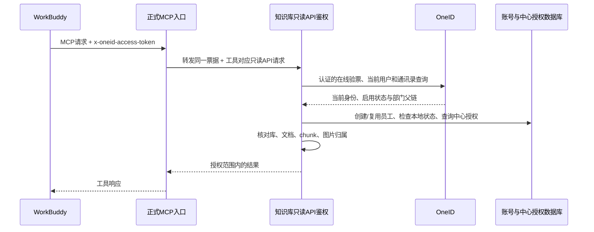

# WorkBuddy 员工账号与中心知识库授权设计

日期：2026-10-15

状态：用户于 2026-10-15 确认继续下一步，书面设计已确认，进入实施计划阶段。生产建号、管理页面和知识库鉴权尚未实现。

本设计承接已跑通的免授权身份原型，替代前期“本企业员工统一访问固定案例库”的授权方案。企业员工可以认证并创建账号；能检索哪些库，由超管配置的中心授权决定。

## 1. 已确认的目标

1. WorkBuddy 自动创建的员工账号，与超管创建的本地账号分开管理。
2. 员工列表显示姓名、所属中心、主部门、完整部门路径、状态和最近访问时间。
3. 超管可以为中心勾选允许检索的知识库，下属部门员工继承这一范围。
4. 首期按员工**主部门所属中心**计算权限，不合并多个所属中心的权限。
5. 首期只授予 MCP 检索能力；未配置授权的库默认拒绝访问。

企业准入仅限配置的本企业：校验可信企业 tid 和目标应用，其他企业员工不能通过身份验证、创建员工账号或检索。本企业员工可认证建号，检索再按中心授权清单执行。

账号来源与管理员角色是不同属性。WorkBuddy 自动建号不获得超管权限，不创建可用密码，不发放网页登录凭据。

## 2. 已实测的身份与组织链路

- 连接器使用“自建应用免授权”，内网 HTTP 的初始化、工具发现和调用已通过。
- 平台在 `x-oneid-access-token` 中携带员工访问令牌。
- 同企业的可信 OneID Discovery 提供 introspection 端点，应用凭据认证后可以查询令牌状态。
- 实际在线验证返回请求客户端 `client_id=codebuddy`，目标 `aud=[所选自建应用 ID]`。这两个标识分别校验，不要求相等。
- 已实测 `active=true`、应用受众/企业/签发者匹配，再通过 UserInfo 核对当前员工。
- 使用同一自建应用的应用级 token，可以查询当前员工正常账号状态及部门父链。
- 已查询得到“后勤服务中心 / AI效率工程部 / AI项目组”。真实账号启用值为 `Enabled`；文档示例为 `Enable`，适配器明确支持这两个值。
- 根部门可能不返回父部门字段，需通过官方 roots 接口确认，不能把任意缺失父节点当成根。

以上已在独立的 9395 测试入口运行，原型有 55 项测试。生产 MCP 9382 仍使用原来的 API Key 机制。

原型中的 `enterprise_membership_verified` 表示 OneID 企业账号处于正常启用状态；它不构成独立的人事在职证明。完整公开的 WorkBuddy 专用换票协议仍未取得，生产验收需增加第二名员工、错误应用、失效令牌的真实联调。

## 3. 用户管理

### 3.1 页面划分

复用超管后台“用户管理”，分为两个页签：

- **本地账号**：现有账号和超管手工创建的账号，保留现有操作。
- **WorkBuddy 员工**：经免授权 MCP 身份验证后自动创建的账号。

现有数据没有可靠的创建者来源记录。迁移时标记为“本地/历史账号”，不能把全部历史用户伪称为“超管创建”。

员工页展示：姓名、账号别名、来源、所属中心、主部门、业务部门路径、OneID 账号状态、本地启用状态、资料同步时间、最近访问时间。详情页可以展开包含公司根节点的完整层级，以及当前生效的知识库授权。

员工页支持姓名/别名搜索、中心筛选、状态筛选和本地停用/启用。第一期不提供员工密码设置、邮件找回、授予超管或物理删除操作；相关后端入口也应拒绝这些操作，不能只隐藏按钮。

这些新入口在当前项目版本可用，不挂到现有 `IS_ENTERPRISE` 商业版开关下面。WorkBuddy 企业版与知识库产品的版本开关分别处理。

### 3.2 自动创建与复用

生产身份唯一键采用 `(enterprise_id, OneID union_id)`，建立到本地 `User.id` 的唯一映射。应用 ID 和应用维度标识另存为别名，不用姓名或邮箱自动合并本地账号。

首次请求在员工身份与 OneID 正常启用状态验证通过后，在一个事务中创建 User 和外部身份记录。并发首次请求依靠数据库唯一约束复用同一账号，不能重复创建。

没有中心授权也可以建号，便于超管看到已接入员工；此时允许知识库集合为空。部门资料缺失、主部门不唯一、中心未标记或路径不完整时，账号显示待同步/未配置状态，知识库访问保持拒绝。

员工再次请求时复用账号并更新姓名、别名、部门父链和同步状态。OneID 同步不能覆盖本地停用开关，更不能自动恢复已停用的本地员工账号。

现有 `User.email` 非空且唯一。无真实邮箱时使用 `wb-<本地用户ID>@workbuddy.invalid` 作为内部存储标识，界面显示姓名和别名，不把它当真实邮箱发送邮件。员工账号密码和网页 access_token 保持为空。

现有 `create_new_user` 会自动创建个人 Tenant、Owner 关系和文件根目录，不能直接用于此流程。现有 `UserService.save` 会把传入的 `password=None` 转成字符串再哈希；新建员工时须省略该参数或提供明确的无密码创建分支。

## 4. 组织与中心授权

### 4.1 组织来源与中心标记

部门 ID、名称、父部门关系来自 OneID。超管可以在已同步的组织节点中标记业务中心；名称和父链本身由 OneID 维护。

初始化只导入已经核实的后勤服务中心节点作为中心定义，**不自动授予任何库**。其他中心通过相同页面标记。员工访问时同步其部门路径，不批量创建全公司员工。

中心标记使用 `(enterprise_id, department_id)`，部门改名不改变授权。不得依赖名字包含“中心”、路径固定第几级或客户端提交的中心名称来做鉴权。

每次根据最新主部门父链和当前中心定义重新计算归属。零个中心命中、多个中心命中、主部门缺失/冲突、父链循环、路径不完整，均不形成可用授权中心。管理页面应提示中心祖先/后代重复标记的冲突。

### 4.2 中心授权页面

超管后台增加“中心知识库授权”入口：选择中心，搜索并勾选有效知识库，保存完整的只读授权清单。示例：后勤服务中心勾选“研发结构案例库”，其下属 AI 项目组员工继承该库的检索权限。

同一知识库可以授权给多个中心；一个中心可以获得多个知识库。授权范围仅为 `knowledge:retrieve`。清空清单表示撤销全部授权，不表示不限制。

保存时验证中心属于当前企业、节点确实被标记为中心、全部知识库存在且有效。整批替换在事务中完成，失败不能保存一半。部门、知识库和中心授权的变更记录操作者及时间。

第一期不加入逐人例外授权、部门间拒绝优先级、多中心权限合并、员工自行申请权限等机制。

### 4.3 权限计算

```text
可访问知识库 = 当前企业 + 员工主部门对应的唯一中心
               在数据库中配置的有效只读知识库清单
```

本地停用、OneID 账号异常、在线验票失败、员工资料查询失败时，当前请求拒绝访问。权限每次请求从数据库重新读取，不把权限复制到员工账号上长期保存。

员工调离中心后，下次请求按新路径计算范围；超管撤销库授权后，下次请求即按新清单检查。OneID 侧变化的生效仍取决于该平台的数据同步，已交付给客户端的内容无法撤回。

## 5. 数据模型

| 模型 | 关键数据与约束 |
| --- | --- |
| `User` 扩展 | `account_source=local/workbuddy`，现有用户回填 local；is_active 由本地管理员控制 |
| `WorkBuddyEmployeeIdentity` | user_id 唯一；enterprise_id + union_id 联合唯一；issuer、应用别名、姓名/账号别名、主部门、已同步父链、中心展示快照、同步状态、资料同步/最近访问时间 |
| `EnterpriseDepartment` | enterprise_id + department_id 联合唯一；名称、parent_id、is_center、同步状态与时间；中心标记由超管维护 |
| `CenterDatasetGrant` | enterprise_id + center_department_id + dataset_id 联合唯一；scope 固定只读、enabled、创建/更新操作者与时间 |

姓名和部门资料是正式账号管理所需的持久化资料；原始令牌、应用 Secret、完整原始 UserInfo/introspection 响应均不入库。应用级 token 只在受保护的内存中缓存，且不超过返回有效期。

先增量建表/加字段和建立唯一索引，再回填本地账号来源。不改动已有知识库的 tenant_id、内容、所有者或 me/team 设置；不导入原型 SQLite 测试用户。

## 6. MCP 与后端接入



### 6.1 凭据传递和信任边界

MCP 新增明确的 WorkBuddy 身份模式，提取 `x-oneid-access-token` 并原样转发到受支持的后端只读 API。工具的模型参数中不加入 Key、员工 ID 或中心 ID。

后端是最终身份和权限检查点；不接受 MCP 转来的明文“已经验过”的用户头，也不使用共享超管 Key 代替个人身份。现有 API Key 模式保留为独立配置路径，WorkBuddy 模式认证失败时不得回退。

OneID 请求目标固定于配置企业的可信端点。校验要求 active=true、requesting client 命中显式 allowlist（当前 codebuddy）、aud 匹配自建应用、issuer 和 tid 匹配、有效期正确、当前用户和通讯录用户 ID 一致且正常启用。保留 UserInfo 与通讯录对 sub/union_id 的独立一致性校验。

请求同时出现 OneID 票据与旧 Authorization、Cookie 时，不能让旧凭据绕过错误票据。重复票据头也必须拒绝。

### 6.2 限定只读接口

新增 `AUTH_WORKBUDDY`，只在 MCP 所需且明确标记只读检索 scope 的接口启用。默认认证集合及超管、管理、写入接口不接受该身份。

覆盖现有四个工具及内部依赖：

- ragflow_retrieval：语义检索；未指定库时仅在当前授权清单检索。
- search_documents：文档列表和名称检索。
- get_document_chunks：授权文档的原文切片。
- get_chunk_image：授权 chunk 的图片。
- GET datasets：只返回当前授权库，避免枚举其他库名称。

空授权时库列表为空，检索提示“暂未配置可访问知识库”。显式请求未授权库或跨库拼接 document_id/chunk_id/image_id 时拒绝，不能先返回部分数据或暴露其他库元信息。

检索、上传、修改、删除、解析任务、原文件下载和管理权限逐接口区分。只读 scope 不因使用 POST 方法而自动被拒绝，也不因使用 GET 方法而自动放行。

### 6.3 员工与数据归属分开

现有 `_load_user` 的 API Key 路径把 token 的 tenant_id 当用户；`add_tenant_id_to_kwargs` 又取 current_user.id。新接入必须保留真实员工为 actor，不能把员工 ID 当作知识库的数据租户。

只读请求建立明确的员工访问上下文，包含 actor_user_id、enterprise_id、center_id、allowed_dataset_ids 和 scope。先检查知识库授权，再从获准 Knowledgebase 记录取得原有 tenant_id，用于索引、文件和模型读取。

现有 me/team 网页授权照常执行自己的规则。WorkBuddy 只读分支不能通过自动加入可编辑团队或伪装库所有者实现。

多库检索保留现有嵌入模型兼容性检查。授权到不同数据所有者的库时，也必须只按这些库解析索引和模型；不能扩大成某所有者的全部库。首次真实检索联调仍仅选择唯一 ID 确认后的“研发结构案例库”。

### 6.4 缓存和停用

首期 WorkBuddy 模式不缓存允许库清单、员工状态或内容元数据，避免沿用当前按 Key/库 ID 缓存造成撤权后可见；后续再按明确的授权版本设计缓存。Discovery 和应用 token 可以按有界有效期缓存。

外部网络请求使用固定超时、无跨域重定向和受限响应大小，不在 Quart 事件循环执行阻塞式网络查询。员工资料只有变化时更新，最近访问写入可以节流，但本地启用状态与授权检查不可节流。

## 7. 代码落点与管理接口

主要复用/扩展位置：

- `api/db/db_models.py`：来源字段与三类新关系模型。
- `api/db/services/`：员工事务建号、组织同步和中心授权服务。
- 新增身份适配模块：将原型的已验证流程整理成后端可用服务，凭据从服务器配置加载。
- `api/apps/__init__.py`：只读接口明确启用 WorkBuddy 身份，建立当前员工上下文。
- `api/apps/api_key_auth.py` 及专用只读访问服务：保留旧 API Key 行为，统一授权库检查入口。
- `api/apps/restful_apis/dataset_api.py`、`document_api.py`、`chunk_api.py` 及对应 service：只读分支按员工授权校验，数据归属仍来自库记录。
- `mcp/server/server.py`：新增凭据模式与对应转发，模型可见工具参数不变。
- `admin/server/routes.py`、`services.py`：员工与中心授权管理接口。
- `web/src/pages/admin/users.tsx`、`user-detail.tsx`：来源分组与员工资料展示。
- 新增中心授权页面，接入 `web/src/routes.tsx` 和超管导航，扩展 admin service 与类型。

新增管理接口采用 `/api/v1/admin/workbuddy/` 前缀，全部要求超管：员工列表/详情、按本地 user_id 停用/启用、已同步组织/中心列表、中心标记、知识库候选清单、中心库授权读取与整批替换。员工管理以 user_id 定位，避免把内部占位邮箱当业务标识。

迁移和纯服务测试沿用当前 Peewee 及单元测试模式。正式部署必须确认使用的 Python/前端构建版本、迁移入口和运行配置，不能把独立测试目录直接当成已经发布的生产功能。

## 8. 分阶段交付

1. **账号与来源管理**：增量迁移，员工事务建号/复用，本地停用，来源分组和组织资料展示；未授权时无库可读。
2. **中心授权管理**：中心定义、授权清单及超管界面，默认拒绝与变更审计；所有写接口由超管控制。
3. **正式 MCP 与检索**：个人票据接入后端只读上下文，四个工具全链路检查，完成固定案例库真实检索。
4. **验收与发布**：双员工、撤权、调部门、错误目标应用、并发建号测试，完成迁移和受控切换。

每一阶段先完成对应可运行测试，再进入下一阶段。生产切换前备份数据库并保留旧入口回滚条件；旧共享 Key 的撤销单独确认影响范围，不与建表混做。

## 9. 必须通过的验收

1. 同一员工多次/并发首次连接只产生一个 WorkBuddy 账号，与本地同名/同邮箱用户保持独立。
2. 本地账号和 WorkBuddy 员工分开显示，来源和管理员角色互不混淆，历史来源不伪造。
3. 后台显示中心及从中心到主部门的路径；同名不同 ID 节点不误合并。
4. 中心 A 员工只能检索 A 清单中的库；未授权库的名字、文档、chunk 和图片均不可获取。
5. 无授权、无中心、主部门/中心歧义、路径不完整、错误企业/应用/请求客户端、失效票据均不能取得知识库内容。
6. 调部门与中心撤权在下一次请求按新状态生效，缓存不能绕过；本地停用不被资料同步重新启用。
7. 工作账号不能设置密码、登录超管后台、获得超管角色、修改库、上传、删除或触发解析。
8. 员工身份和数据租户不混用；授权不同所有者的库时只读取指定库，异构嵌入模型按现有规则明确报错。
9. 相同企业两名真实员工分别建号，分别检索并能在后台审计到正确 actor。
10. 前端隐藏不作为权限保障，直接请求后端也必须执行同样检查；OneID 异常时不回退到旧 Key 或会话。
11. 迁移重复执行安全，历史用户和已有网页/API Key 功能通过回归测试。

## 10. 第一轮验证配置

沿用现有企业自建应用与 OneID 配置；只从服务器安全配置读取 Secret。中心选择已核实的后勤服务中心；知识库选择“研发结构案例库”的真实唯一 ID，列表里同名时必须确认具体库后才配置授权。

本文件不包含应用 Secret、员工令牌、生产授权写入或数据库迁移执行结果。当前仅完成设计与原型能力验证，下一份实施计划应据此列出具体改动、测试和发布步骤。
